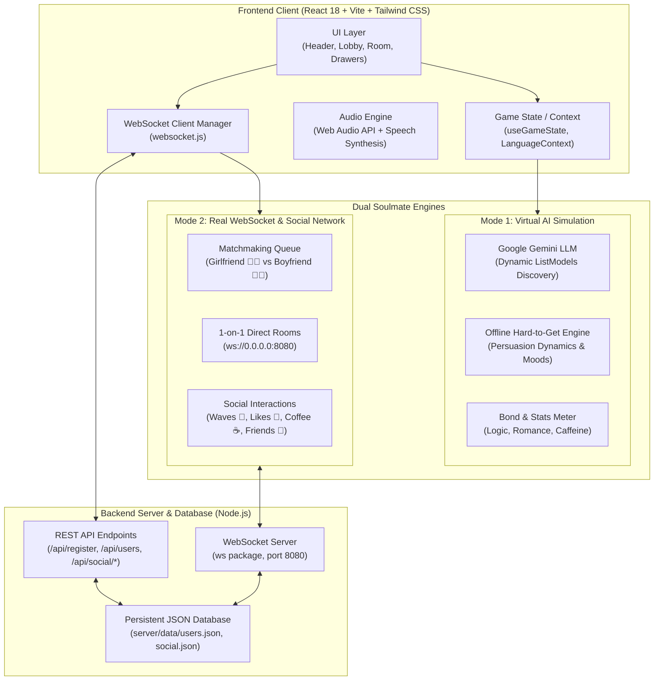

# Find My Soulmate — System Architecture & Design Documentation

## 1. System Overview

**"Find My Soulmate"** is a dual-mode, developer-themed dating simulation and real-time social matchmaking platform. Designed specifically for software engineers, developers, and tech enthusiasts, it blends gamified romantic simulation with realistic psychological resistance, criteria-driven developer matching, live peer-to-peer WebSocket messaging, and a persistent community database.

---

## 2. High-Level Architecture Diagram



---

## 3. Dual-Engine Architecture

### Engine A: Virtual / AI Developer Soulmates (`chatMode: 'virtual'`)
1. **Dynamic Character Personalities**:
   - 6 characters (3 female, 3 male): Lina, Dani, Senait, Linus, Devon, Dawit.
   - Strict gender filtering: Selecting "Girlfriend" surfaces only female soulmates; selecting "Boyfriend" surfaces only male soulmates (no mixed cross-gender default).
2. **Realistic "Hard-to-Get" Psychological Dynamics**:
   - Realistic conversational resistance: characters do not immediately say "yes" or express unearned romantic affection.
   - Bond progress thresholds require persuasion, common ground, and thoughtful engagement before unlocking deeper intimacy levels (`Stranger` -> `Acquaintance` -> `Friend` -> `Crush` -> `Soulmate`).
3. **Google Gemini LLM Integration**:
   - Dynamic `ListModels` API call discovers available models (preventing deprecated `gemini-pro` failures on `v1beta`).
   - Strict system instruction prevents AI boilerplate leakage (e.g., removing Markdown meta-commentary, bracketed notes, or prompt echoes).
4. **Offline Fallback Simulation**:
   - When no Gemini API key is configured or offline, the internal behavioral engine simulates responsive developer replies, mood swings, typing delays, and love quotes in both English and Amharic.

---

### Engine B: Real-Time WebSocket & Social Matchmaking (`chatMode: 'real_ws'`)
1. **Persistent Developer Database**:
   - Powered by `server/db.js` writing to `server/data/users.json` and `server/data/social.json`.
   - Pre-seeded with realistic online developers (Meron, Hanna, Selamawit, Yonas, Alex, Kenean).
   - Persists all registrations, bio details, friends graph, and profile likes.
2. **Live Presence & Direct 1-on-1 Rooms**:
   - Node.js WebSocket backend (`server/server.js`) on port `8080`.
   - Supports room creation, typing debouncing, instant messaging, and audio note metadata.
3. **Social Community Layer**:
   - **Coffee Waves 👋**: 1-click friendly greeting triggering cross-device chime and toast.
   - **Developer Love 💖**: Increments persistent profile likes in database.
   - **Friend Network 👥**: Add to mutual developer circle and view in dedicated "My Friends" tab.
   - **Dev Social Feed 🚀**: Post real-time coding thoughts, coffee cravings, and status updates.

---

## 4. Cross-Device Connectivity (PC ↔ Mobile Phone)

The platform supports seamless local network testing across PC and mobile devices (via Mobile Hotspot or same Wi-Fi router).

```mermaid
sequenceDiagram
    participant Phone as Mobile Browser (Phone)
    participant PCUI as PC Browser
    participant Server as Node.js Server (Port 8080)

    Phone->>Server: HTTP POST /api/register (Developer Card)
    Server-->>Phone: 200 OK (User saved to users.json)
    Server->>PCUI: WebSocket broadcast (community:new_user)
    PCUI-->>PCUI: Display announcement toast & refresh lobby

    Phone->>Server: WebSocket social:interact (wave to PC)
    Server->>PCUI: Forward wave notification
    PCUI-->>PCUI: Play chime & show "👋 Coffee wave received!"

    Phone->>Server: WebSocket room:invite (Direct Chat)
    Server->>PCUI: WebSocket room:joined
    Server->>Phone: WebSocket room:joined
    Phone<-->>PCUI: Bidirectional 1-on-1 WebSocket Chat
```

* **Dynamic Host Detection**: `src/services/websocket.js` dynamically extracts `window.location.hostname`, allowing mobile devices to automatically route WebSocket connections to the PC host IP (`192.168.137.1` or `10.240.41.200`) without manual code changes.
* **Responsive Mobile Layout**: On screens `< 768px`, the mobile drawer (`MobileNavDrawer`) and compact chat header ensure no element overflows, while the `📊 Stats` toggle opens the partner sidebar on demand.

---

## 5. Directory Structure

```text
find-my-soulmate/
├── docs/                             # System Architecture & Flow Documentation
│   ├── ARCHITECTURE.md               # Architecture, engine design & diagrams
│   └── SYSTEM_FLOW.md                # Sequence diagrams, REST API & socket specs
├── server/                           # Backend Node.js Server
│   ├── server.js                     # WebSocket server & HTTP REST endpoints
│   ├── db.js                         # Lightweight JSON database driver
│   └── data/                         # Persistent JSON storage
│       ├── users.json                # Registered developer accounts & profiles
│       └── social.json               # Developer social feed & interaction events
├── src/                              # Frontend React Application
│   ├── components/
│   │   ├── character/                # Character selection & cards
│   │   ├── chat/                     # Message feed, bubbles, typing indicators
│   │   ├── gifts/                    # Gift selection modal & categories
│   │   ├── guide/                    # About & dating guide modal
│   │   ├── layout/                   # HeaderBar, Sidebar, Footer, MobileNavDrawer
│   │   ├── onboarding/               # First-time user onboarding modal
│   │   ├── realchat/                 # Live WebSocket Lobby, Room, DevRegisterModal, RealPeerSidebar
│   │   ├── settings/                 # API Key modal, profile settings
│   │   └── ui/                       # StatBar, Icons, MoodToast, LanguageToggle
│   ├── context/                      # LanguageContext (EN 🇺🇸 / AM 🇪🇹)
│   ├── data/                         # Character profiles, translations, gifts, romantic quotes
│   ├── hooks/                        # useGameState (AI dialogue engine & bond state)
│   ├── services/                     # websocket.js (Client WebSocket Manager & REST helpers)
│   └── utils/                        # Audio engine, Gemini API connector, localStorage
├── package.json                      # Dependencies & build scripts
├── vite.config.js                    # Vite configuration (host: true on port 5173)
└── tailwind.config.js                # Tailwind styling & dark terminal palette
```
