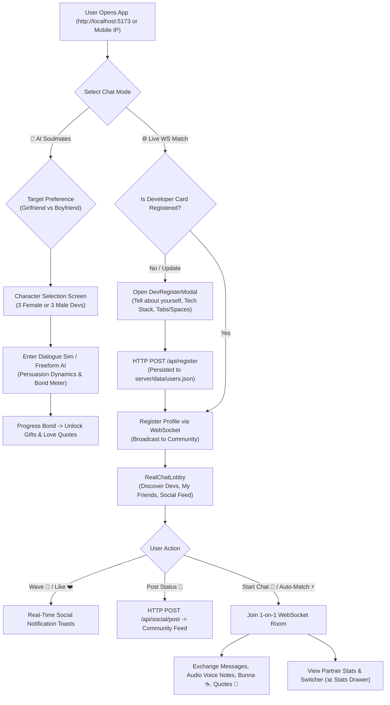

# Find My Soulmate — System Flow & API Specifications

## 1. User Journey & Registration Flow



---

## 2. REST API Reference (Port 8080)

All HTTP endpoints support CORS and return JSON.

### 2.1 Health Check
* **Endpoint**: `GET /health`
* **Response**:
  ```json
  {
    "status": "ok",
    "onlineSockets": 2,
    "registeredUsers": 8,
    "time": "2026-10-22T08:00:00.000Z"
  }
  ```

### 2.2 Register / Update Developer Card
* **Endpoint**: `POST /api/register`
* **Request Body**:
  ```json
  {
    "id": "dev_1792616038",
    "name": "Dawit Bekele",
    "handle": "@dawit_code",
    "gender": "male",
    "lookingFor": "female",
    "location": "Addis Ababa 🇪🇹",
    "techStack": ["React", "TypeScript", "Node.js"],
    "bio": "Building scalable web apps and addicted to Ethiopian bunna.",
    "indentation": "Tabs",
    "drink": "☕ Ethiopian Bunna",
    "emoji": "👨‍💻"
  }
  ```
* **Response**:
  ```json
  {
    "ok": true,
    "user": { ... }
  }
  ```

### 2.3 List All Registered Developers
* **Endpoint**: `GET /api/users`
* **Response**:
  ```json
  {
    "ok": true,
    "users": [ ... ]
  }
  ```

### 2.4 Social Interactions (Wave, Like, Friend)
* **Endpoint**: `POST /api/social/action`
* **Request Body**:
  ```json
  {
    "action": "wave", // "wave" | "like" | "add_friend"
    "fromUser": { "id": "dev_1", "name": "Dawit", "handle": "@dawit" },
    "targetUserId": "user_meron"
  }
  ```
* **Response**:
  ```json
  {
    "ok": true,
    "action": "wave",
    "targetUser": { ... }
  }
  ```

### 2.5 Developer Social Feed (Posts & Updates)
* **GET `/api/social/feed`**: Returns recent developer status updates.
* **POST `/api/social/post`**: Posts a new thought/status to the feed.

---

## 3. WebSocket Protocol Specification

The WebSocket server runs at `ws://<host>:8080`.

| Event Type | Direction | Description |
| :--- | :--- | :--- |
| `connected` | Server -> Client | Initial acknowledgment with `clientId` and server timestamp |
| `profile:register` | Client -> Server | Register client identity and preferences; saves to database |
| `presence:update` | Server -> Broadcast | List of active developers and their connection states |
| `match:find` | Client -> Server | Request automated matchmaking with preferred gender |
| `match:success` | Server -> Client | Match found; provides `roomId` and matched peer card |
| `room:invite` | Client -> Server | Direct 1-on-1 chat initiation with a specific peer |
| `room:joined` | Server -> Client | Confirmation of room entry |
| `chat:send` | Client -> Server | Send text message, voice note, or gift payload to room members |
| `chat:message` | Server -> Client | Incoming chat message |
| `chat:typing` | Bidirectional | Live typing indicator broadcast within room |
| `social:interact` | Client -> Server | Send real-time coffee wave, profile like, or friend request |
| `community:toast` | Server -> Broadcast | Global or targeted real-time community notification popup |
| `room:leave` | Client -> Server | Gracefully leave active room |
| `room:peer_left` | Server -> Client | Informs remaining room member that partner left |

---

## 4. Criteria Matching Formula

The platform dynamically calculates criteria compatibility between two developer cards:

$$\text{Match Score} = \min(99, 65 + (|\text{Shared Tech}| \times 10) + \text{IndentBonus} + \text{DrinkBonus})$$

Where:
* $\text{Shared Tech} = \text{TechStack}_A \cap \text{TechStack}_B$
* $\text{IndentBonus} = 8\%$ if both prefer Tabs or both prefer Spaces
* $\text{DrinkBonus} = 5\%$ if both choose the same fuel (e.g., *☕ Ethiopian Bunna*)
* Baseline chemistry starts at $65\%$ and scales up to $99\%$.
